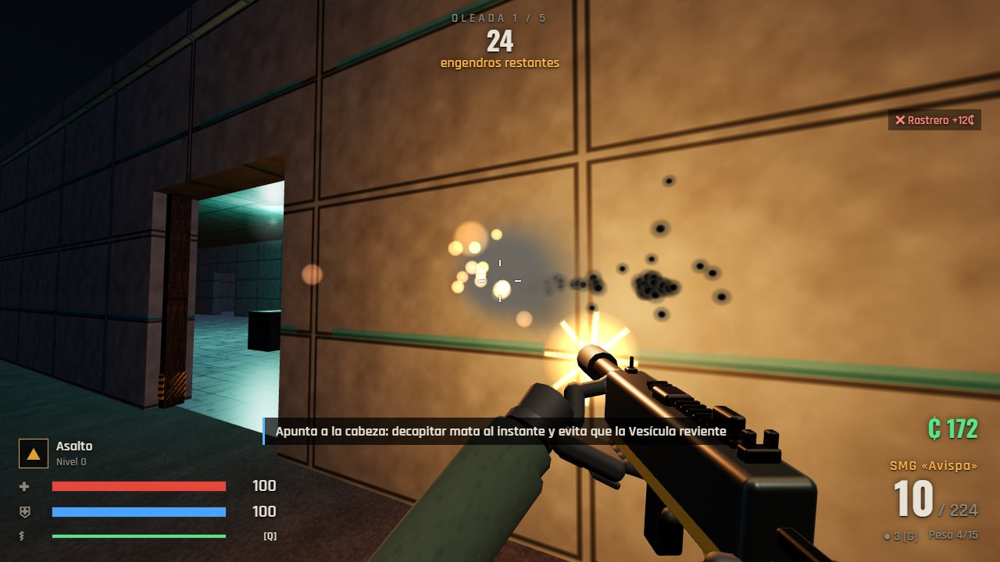
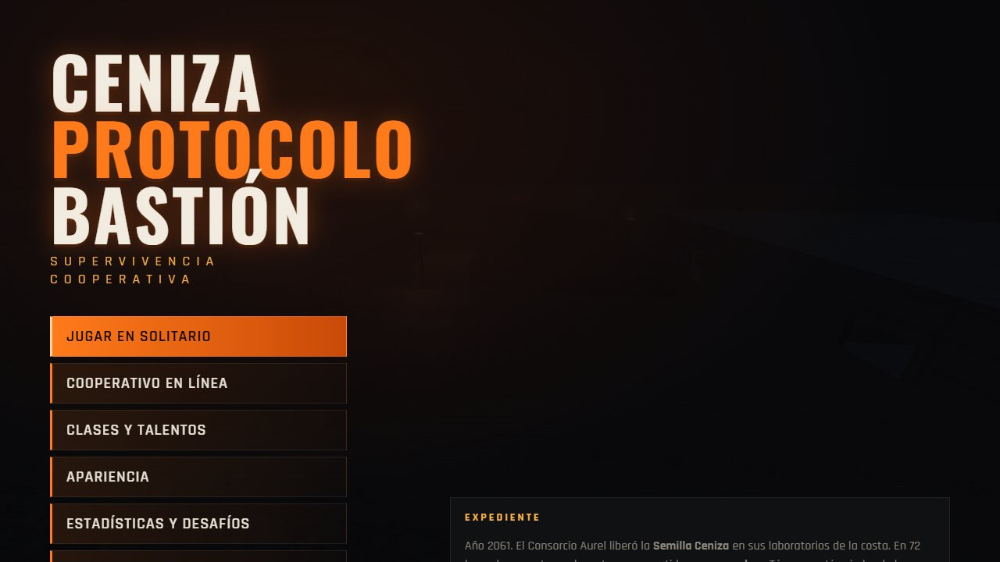
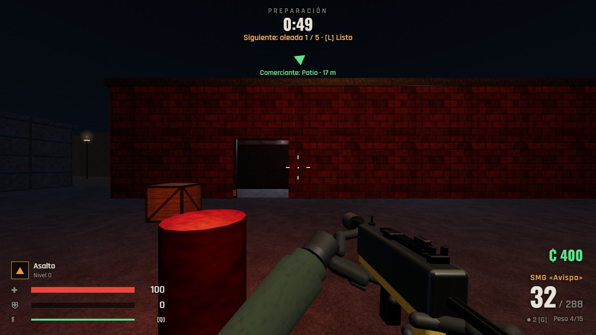
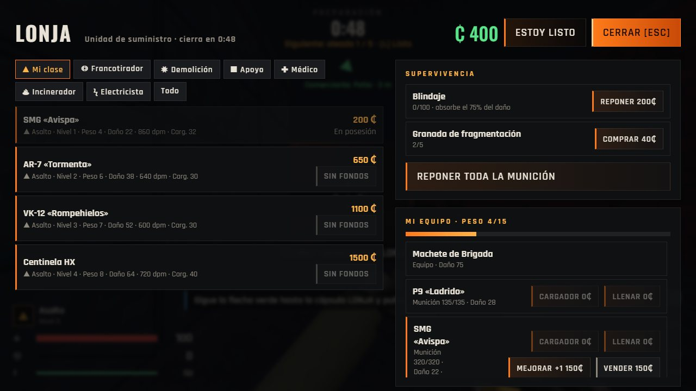
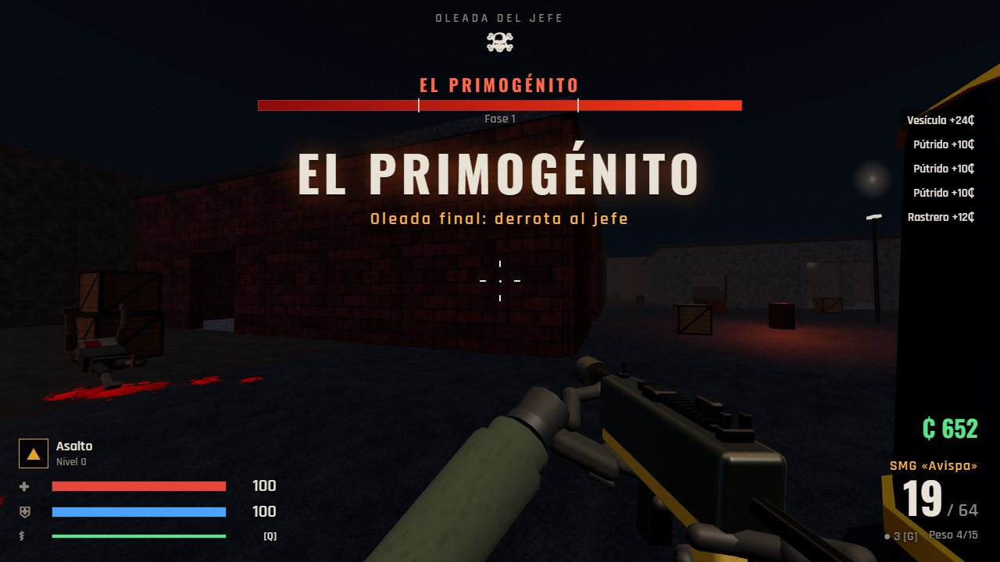

<p align="center"><a href="README.md">Español</a> · <b>English</b></p>

<div align="center">

# CENIZA: Protocolo Bastión

**A first-person wave-survival shooter for the browser, with online co-op.**
100% procedural art, sound and music: not a single downloaded texture or audio file.

[](https://virtuanista.github.io/ceniza-protocolo-bastion/)




</div>

> *The year is 2061. The Aurel Consortium released the **Ash Seed** in its coastal laboratories.*
> You are a Cleaner of the Bastion Brigade: hold out against the waves of spawn, weld doors,
> buy gear at the **LONJA** pod between assaults and put an end to **El Primogénito** (the Firstborn).

## Contents

- [Screenshots](#screenshots)
- [How to play](#how-to-play)
- [Controls](#controls)
- [What's in the game](#whats-in-the-game)
- [Technical notes](#technical-notes)
- [Architecture](#architecture)
- [Automated tests](#automated-tests)
- [Credits and license](#credits-and-license)

## Screenshots

| | |
|---|---|
|  |  |
| **Main menu** | **Deployment at Estación Ceniza** |
|  |  |
| **The LONJA: shop between waves** | **Final wave: El Primogénito** |

## How to play

### In the browser (single player)

Go to **[virtuanista.github.io/ceniza-protocolo-bastion](https://virtuanista.github.io/ceniza-protocolo-bastion/)** and click *Jugar en solitario* (Play solo). It works in desktop Chrome, Edge and Firefox, with nothing to install.

> The web version is single-player only. GitHub Pages only serves static files and co-op needs a WebSocket server, so to play with friends you have to run it locally.

### Locally (with co-op)

You need [Node.js](https://nodejs.org) 18 or later.

```bash
git clone https://github.com/virtuanista/ceniza-protocolo-bastion.git
cd ceniza-protocolo-bastion
npm install
npm start          # builds and serves the game and co-op at http://localhost:8787
```

The other players connect from *Cooperativo en línea* (Online co-op) with `ws://HOST-IP:8787`.

| Command | What it does |
|---|---|
| `npm run dev` | Client with hot reload at http://localhost:5173 |
| `npm run server` | Co-op server only, at `ws://localhost:8787` |
| `npm run build` | Builds the static version into `dist/` |
| `npm start` | Builds and serves everything together |

## Controls

They can be remapped in **Opciones** (Options).

| Action | Key |
|---|---|
| Move · sprint · jump · crouch | WASD · Shift · Space · C / Ctrl |
| Aim · shoot · sights | Mouse · left click · right click |
| Reload · switch weapon | R · 1-4 / wheel / X |
| Interact (doors, LONJA, objectives, revive, resupply) | E |
| Quick heal · grenade · quick melee · welder | Q · G · V · T |
| Flashlight · ready · scoreboard | F · L · Tab |
| Drop credits · chat (co-op) | Z · Enter |
| Pause | Esc |

## What's in the game

- **Modes**: short game (4 waves + boss), medium (7 + boss), long (10 + boss) and endless (a boss every 5 waves). Difficulties: Normal, Difícil (Hard), Suicida (Suicidal) and Infierno (Hell).
- **3 maps**:
  - *Estación Ceniza* (Ash Station): yard, warehouse, laboratory, garage and dock, with 9 horde entrances and 11 weldable doors.
  - *Hospital Santa Ermita*: wards, operating rooms and atrium, with 8 entrances and 11 doors.
  - *Metro Línea Cero* (Line Zero Metro): raised platforms with stairs that act as a bottleneck, tracks with train cars, tunnels at both ends and a concourse, with 9 entrances and 5 doors.
- **7 classes** with per-level passives (1 to 25) and 5 tiers of talents to choose from: Asalto (Assault), Francotirador (Sniper), Demolición (Demolition), Apoyo (Support), Médico (Medic), Incinerador (Incinerator) and Electricista (Electrician).
- **32 weapons**: pistols, submachine guns, rifles, shotguns, sniper rifles, machine gun, grenade launcher, rockets, sticky charges, flamethrower, plasma, electric arcs, continuous beam, rail, medical weapons, machete, syringe and welder. Each has its own rate of fire, spread, recoil, magazine, reload type, model, animation and sound. There are 3 upgrade levels and a weight system.
- **7 grenade types** depending on class: fragmentation, cluster, nail, sticky, incendiary, EMP and medical.
- **Bestiary**:

  | Spawn | What makes it dangerous |
  |---|---|
  | Pútrido / Pútrido Alfa (Putrid / Alpha Putrid) | The Alpha wears a helmet and rallies the others |
  | Rastrero (Crawler) | Hunts in packs and leaps |
  | Acechador (Stalker) | Camouflages itself and flanks |
  | Vesícula (Vesicle) | Vomits acid and bursts, unless you decapitate it |
  | Escupidor (Spitter) | Attacks from a distance and keeps it |
  | Aullador (Howler) | Its scream breaks welds and cancels projectiles |
  | Desgarrador (Ripper) | Saws and fury |
  | Coloso (Colossus) | Becomes enraged as damage accumulates, and charges |

  There are also elite versions.
- **El Primogénito** (the Firstborn): a 3-phase boss with spikes, a seismic slam (you have to jump), charges into walls, homing acid orbs, summons, a hiding phase with regeneration, and windows in which it leaves its heart exposed.
- **Optional objectives**: defend an area, repair a device, carry an object or hold a position.
- **Tiempo Muerto** (Dead Time): bullet time, with talents that interact with it.
- **Persistent progression**: per-class XP, levels, talents, statistics, records, 14 challenges and unlockable cosmetics (uniforms and weapon finishes).
- **Online co-op for up to 6 players**: room with a code, chat, health and enemy count scaled to the number of players, reviving, ranged healing, ammo resupply (Apoyo), shareable credits, and defeat only if everyone goes down.

## Technical notes

- **Nothing is downloaded**: textures are painted onto a `canvas` at startup, the weapon, creature and player models are built from geometry in code, and the effects, voices and music are synthesized with Web Audio.
- **The music reacts to the game**: it is made of layers that come in and out depending on the tension of the wave.
- **AI with flow fields**: the spawn do not calculate their routes one by one. A distance map (Dijkstra) is computed over a grid with heights, and each creature simply moves downhill. This lets dozens of enemies move around the map at almost no cost.
- **Performance**: map geometry is merged by material (≈1 draw call per material) and there are fixed *pools* of lights, particles, decals and debris. In the stress test, with 34 active spawn, median CPU time is ~1 ms per frame and the worst frame takes less than 8 ms.
- **Host-authoritative co-op**: the horde simulation runs on the host's computer, and the server only acts as a room and relays messages.

## Architecture

| Module | Path | Responsibility |
|---|---|---|
| Core | `src/core/` | Input with pointer lock, event bus and utilities |
| Render | `src/render/` | Renderer (world and weapon layer), procedural textures, particles with *pools*, decals, physical debris and models |
| World and physics | `src/world/` | Maps, merged geometry, cylinder-AABB collisions with a spatial grid, raycasts, doors and navigation |
| Weapons | `src/weapons/` | Definitions, inventory, firing, reloading, animation, projectiles and areas |
| AI | `src/ai/` | Bestiary, enemy manager (chasing, flanking, surrounding, specials, gore) and boss |
| Game | `src/game/` | Session, combat, player, waves, objectives, economy and classes |
| Audio | `src/audio/` | Effect and voice synthesis, 3D engine with reverb and dynamic music |
| Interface | `src/ui/` | HUD and menus |
| Saving | `src/save/` | Progress, challenges, cosmetics and settings in `localStorage` |
| Network | `src/net/`, `server/` | WebSocket client and room server |

## Automated tests

With `npm run dev` running (and `npm run server` for the co-op test):

```bash
node tools/smoke.mjs      # full game: LONJA, waves, boss and victory
node tools/controls.mjs   # keyboard, weapons, grenade, healing, doors and welding
node tools/ai.mjs         # AI navigation and attacks (MAP=hospital for the second map)
node tools/systems.mjs    # objectives, Tiempo Muerto, endless, saving and menus
node tools/coop.mjs       # two real clients: room, wave, replication, damage and healing
node tools/perf.mjs       # performance stress test
node tools/prof.mjs       # per-system profile
node tools/gallery.mjs    # weapon and creature captures (CLOSE=1 NOHUD=1 AIM=1 ONLY=ar7,p9)
node tools/viewmodel.mjs  # still views of the weapon and hands (ONLY=ar7 FOCUS=L,R)
```

They require Google Chrome to be installed (they use `puppeteer-core`).

## Credits and license

Original code, art, sound and music, released under the [MIT](LICENSE) license.

Libraries: [three.js](https://threejs.org) (MIT), [ws](https://github.com/websockets/ws) (MIT), [Vite](https://vitejs.dev) (MIT) and puppeteer-core (Apache-2.0, only for the tests). Rajdhani and Oswald fonts (SIL Open Font License).

<p align="center">
	Repository made by <a href="https://github.com/virtuanista" target="_blank">virtu 🎣</a>
</p>

<p align="center">
	
</p>

<p align="center">
	Copyright &copy; 2026
</p>

<p align="center">
	<a href="LICENSE"></a>
</p>
