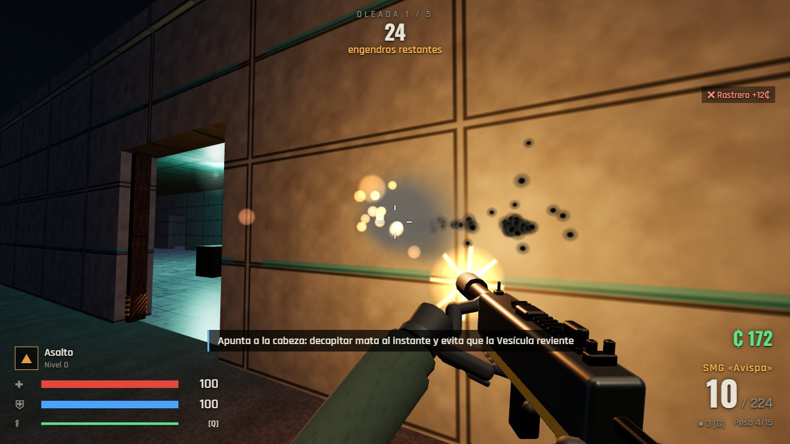
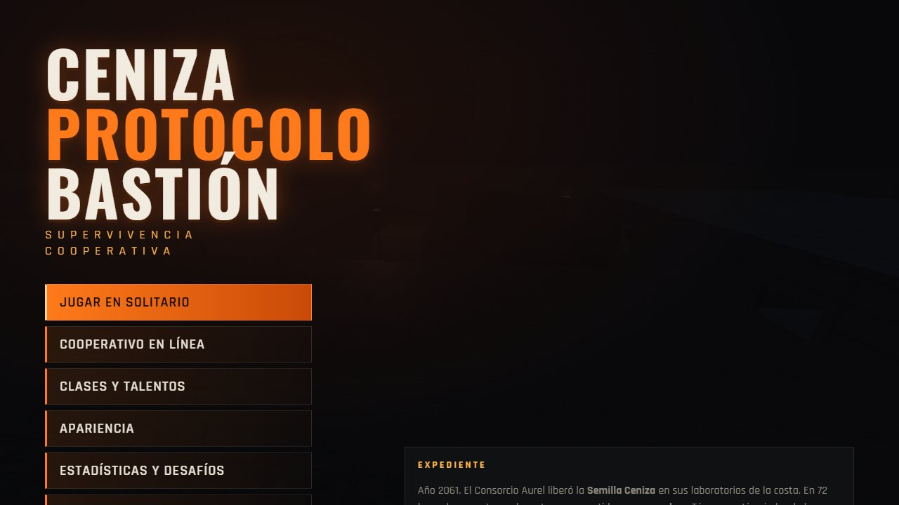
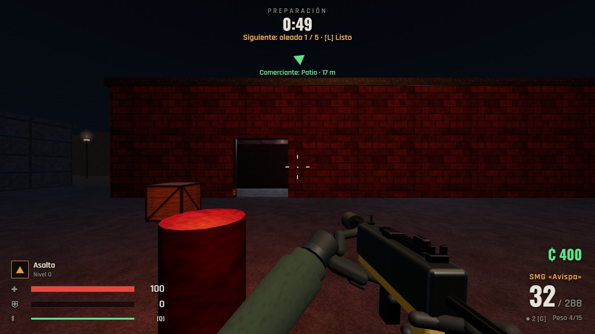
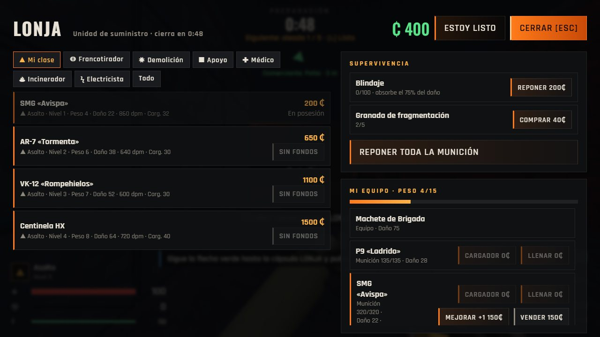
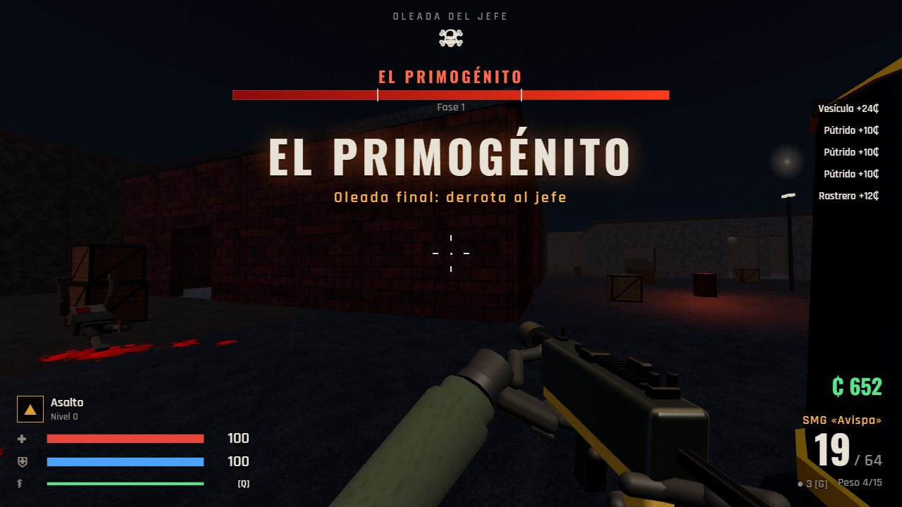

<div align="center">

# CENIZA: Protocolo Bastión

**Shooter de supervivencia por oleadas en primera persona, para el navegador y con cooperativo online.**
Arte, sonido y música 100 % procedurales: no hay ni una textura ni un audio descargado.

[](https://virtuanista.github.io/ceniza-protocolo-bastion/)




</div>

> *Año 2061. El Consorcio Aurel liberó la **Semilla Ceniza** en sus laboratorios de la costa.*
> Eres un Limpiador de la Brigada Bastión: aguanta las oleadas de engendros, suelda puertas,
> compra equipo en la cápsula **LONJA** entre asaltos y acaba con **el Primogénito**.

## Índice

- [Capturas](#capturas)
- [Cómo jugar](#cómo-jugar)
- [Controles](#controles)
- [Contenido](#contenido)
- [Curiosidades técnicas](#curiosidades-técnicas)
- [Arquitectura](#arquitectura)
- [Pruebas automáticas](#pruebas-automáticas)
- [Créditos y licencia](#créditos-y-licencia)

## Capturas

| | |
|---|---|
|  |  |
| **Menú principal** | **Despliegue en la Estación Ceniza** |
|  |  |
| **La LONJA: tienda entre oleadas** | **Oleada final: El Primogénito** |

## Cómo jugar

### En el navegador (un jugador)

Entra en **[virtuanista.github.io/ceniza-protocolo-bastion](https://virtuanista.github.io/ceniza-protocolo-bastion/)** y pulsa *Jugar en solitario*. Funciona en Chrome, Edge y Firefox de escritorio y no hay que instalar nada.

> La versión web es solo para un jugador. GitHub Pages solo sirve ficheros estáticos y el cooperativo necesita un servidor WebSocket, así que para jugar con amigos hay que ejecutarlo en local.

### En local (con cooperativo)

Hace falta [Node.js](https://nodejs.org) 18 o superior.

```bash
git clone https://github.com/virtuanista/ceniza-protocolo-bastion.git
cd ceniza-protocolo-bastion
npm install
npm start          # compila y sirve el juego y el cooperativo en http://localhost:8787
```

Los demás jugadores se conectan desde *Cooperativo en línea* con `ws://IP-del-anfitrión:8787`.

| Comando | Para qué sirve |
|---|---|
| `npm run dev` | Cliente con recarga en caliente en http://localhost:5173 |
| `npm run server` | Solo el servidor cooperativo, en `ws://localhost:8787` |
| `npm run build` | Compila la versión estática en `dist/` |
| `npm start` | Compila y sirve todo junto |

## Controles

Se pueden reasignar en **Opciones**.

| Acción | Tecla |
|---|---|
| Moverse · esprintar · saltar · agacharse | WASD · Shift · Espacio · C / Ctrl |
| Apuntar · disparar · mirilla | Ratón · clic izquierdo · clic derecho |
| Recargar · cambiar de arma | R · 1-4 / rueda / X |
| Interactuar (puertas, LONJA, objetivos, reanimar, reabastecer) | E |
| Curación rápida · granada · golpe rápido · soldador | Q · G · V · T |
| Linterna · listo · marcador | F · L · Tab |
| Soltar créditos · chat (cooperativo) | Z · Enter |
| Pausa | Esc |

## Contenido

- **Modos**: partida corta (4 oleadas + jefe), media (7 + jefe), larga (10 + jefe) e interminable (un jefe cada 5 oleadas). Dificultades Normal, Difícil, Suicida e Infierno.
- **3 mapas**:
  - *Estación Ceniza*: patio, almacén, laboratorio, garaje y muelle, con 9 accesos de horda y 11 puertas soldables.
  - *Hospital Santa Ermita*: pabellones, quirófanos y atrio, con 8 accesos y 11 puertas.
  - *Metro Línea Cero*: andenes elevados con escaleras que hacen de cuello de botella, vías con vagones, túneles en ambos extremos y vestíbulo, con 9 accesos y 5 puertas.
- **7 clases** con pasivas por nivel (del 1 al 25) y 5 niveles de talentos a elegir: Asalto, Francotirador, Demolición, Apoyo, Médico, Incinerador y Electricista.
- **32 armas**: pistolas, subfusiles, fusiles, escopetas, francotiradores, ametralladora, lanzagranadas, cohetes, cargas adhesivas, lanzallamas, plasma, arcos eléctricos, haz continuo, riel, armas médicas, machete, jeringa y soldador. Cada una tiene su cadencia, dispersión, retroceso, cargador, tipo de recarga, modelo, animación y sonido. Hay 3 niveles de mejora y un sistema de peso.
- **7 tipos de granada** según la clase: fragmentación, racimo, clavos, adhesiva, incendiaria, EMP y médica.
- **Bestiario**:

  | Engendro | Qué lo hace peligroso |
  |---|---|
  | Pútrido / Pútrido Alfa | El Alfa lleva casco y arenga a los demás |
  | Rastrero | Caza en manada y salta |
  | Acechador | Se camufla y flanquea |
  | Vesícula | Vomita ácido y revienta, salvo si la decapitas |
  | Escupidor | Ataca a distancia y la mantiene |
  | Aullador | Su grito rompe soldaduras y anula proyectiles |
  | Desgarrador | Sierras y furia |
  | Coloso | Se enfurece con el daño acumulado y embiste |

  Además hay versiones de élite.
- **El Primogénito**: un jefe en 3 fases, con espinas, golpe sísmico (hay que saltar), embestida contra las paredes, orbes ácidos teledirigidos, invocaciones, fase de ocultación con regeneración y ventanas en las que deja el corazón expuesto.
- **Objetivos opcionales**: defender una zona, reparar un dispositivo, transportar un objeto o resistir en un punto.
- **Tiempo Muerto**: tiempo bala, con talentos que interactúan con él.
- **Progresión persistente**: XP por clase, niveles, talentos, estadísticas, récords, 14 desafíos y cosméticos desbloqueables (uniformes y acabados de armas).
- **Cooperativo en línea, hasta 6 jugadores**: sala con código, chat, vida y número de enemigos escalados según los jugadores, reanimación, curación a distancia, reabastecimiento de munición (Apoyo), créditos que se pueden compartir y derrota solo si caen todos.

## Curiosidades técnicas

- **Nada se descarga**: las texturas se pintan en un `canvas` al arrancar, los modelos de armas, criaturas y jugadores se construyen con geometría en código, y los efectos, las voces y la música se sintetizan con Web Audio.
- **La música reacciona a la partida**: está hecha por capas que entran y salen según la tensión de la oleada.
- **IA con campos de flujo**: los engendros no calculan su ruta uno por uno. Se calcula un mapa de distancias (Dijkstra) sobre una rejilla con alturas, y cada criatura solo baja por la pendiente. Así decenas de enemigos se mueven por el mapa casi sin coste.
- **Rendimiento**: la geometría del mapa se fusiona por material (≈1 draw call por material) y hay *pools* fijos de luces, partículas, calcomanías y restos. En la prueba de estrés, con 34 engendros activos, la mediana de CPU es de ~1 ms por fotograma y el peor fotograma tarda menos de 8 ms.
- **Cooperativo con anfitrión autoritativo**: la simulación de la horda corre en el equipo del anfitrión y el servidor solo hace de sala y reenvía mensajes.

## Arquitectura

| Módulo | Ruta | Responsabilidad |
|---|---|---|
| Núcleo | `src/core/` | Entrada con bloqueo de puntero, bus de eventos y utilidades |
| Render | `src/render/` | Renderizador (mundo y capa del arma), texturas procedurales, partículas con *pools*, calcomanías, restos físicos y modelos |
| Mundo y física | `src/world/` | Mapas, geometría fusionada, colisiones cilindro-AABB con rejilla espacial, raycasts, puertas y navegación |
| Armas | `src/weapons/` | Definiciones, inventario, disparo, recarga, animación, proyectiles y áreas |
| IA | `src/ai/` | Bestiario, gestor de enemigos (persecución, flanqueo, rodeo, especiales, gore) y jefe |
| Juego | `src/game/` | Sesión, combate, jugador, oleadas, objetivos, economía y clases |
| Audio | `src/audio/` | Síntesis de efectos y voces, motor 3D con reverberación y música dinámica |
| Interfaz | `src/ui/` | HUD y menús |
| Guardado | `src/save/` | Progreso, desafíos, cosméticos y ajustes en `localStorage` |
| Red | `src/net/`, `server/` | Cliente WebSocket y servidor de salas |

## Pruebas automáticas

Con `npm run dev` en marcha (y `npm run server` para la prueba de cooperativo):

```bash
node tools/smoke.mjs      # partida completa: LONJA, oleadas, jefe y victoria
node tools/controls.mjs   # teclado, armas, granada, curación, puertas y soldadura
node tools/ai.mjs         # navegación y ataques de la IA (MAP=hospital para el segundo mapa)
node tools/systems.mjs    # objetivos, Tiempo Muerto, interminable, guardado y menús
node tools/coop.mjs       # dos clientes reales: sala, oleada, réplica, daño y curación
node tools/perf.mjs       # prueba de estrés de rendimiento
node tools/prof.mjs       # perfil por sistema
node tools/gallery.mjs    # capturas de armas y criaturas (CLOSE=1 NOHUD=1 AIM=1 ONLY=ar7,p9)
node tools/viewmodel.mjs  # vistas fijas del arma y las manos (ONLY=ar7 FOCUS=L,R)
```

Necesitan Google Chrome instalado (usan `puppeteer-core`).

## Créditos y licencia

Código, arte, sonido y música originales, publicados con licencia [MIT](LICENSE).

Librerías: [three.js](https://threejs.org) (MIT), [ws](https://github.com/websockets/ws) (MIT), [Vite](https://vitejs.dev) (MIT) y puppeteer-core (Apache-2.0, solo para las pruebas). Fuentes Rajdhani y Oswald (SIL Open Font License).

<details>
<summary><b>In English</b></summary>

*CENIZA: Protocolo Bastión* is a first-person wave-survival shooter for the browser with online co-op for up to 6 players. Every texture, model, sound effect and music track is generated procedurally at runtime with three.js and Web Audio. [Play the single-player version in your browser](https://virtuanista.github.io/ceniza-protocolo-bastion/), or clone the repo and run `npm install && npm start` to play co-op locally.

</details>
